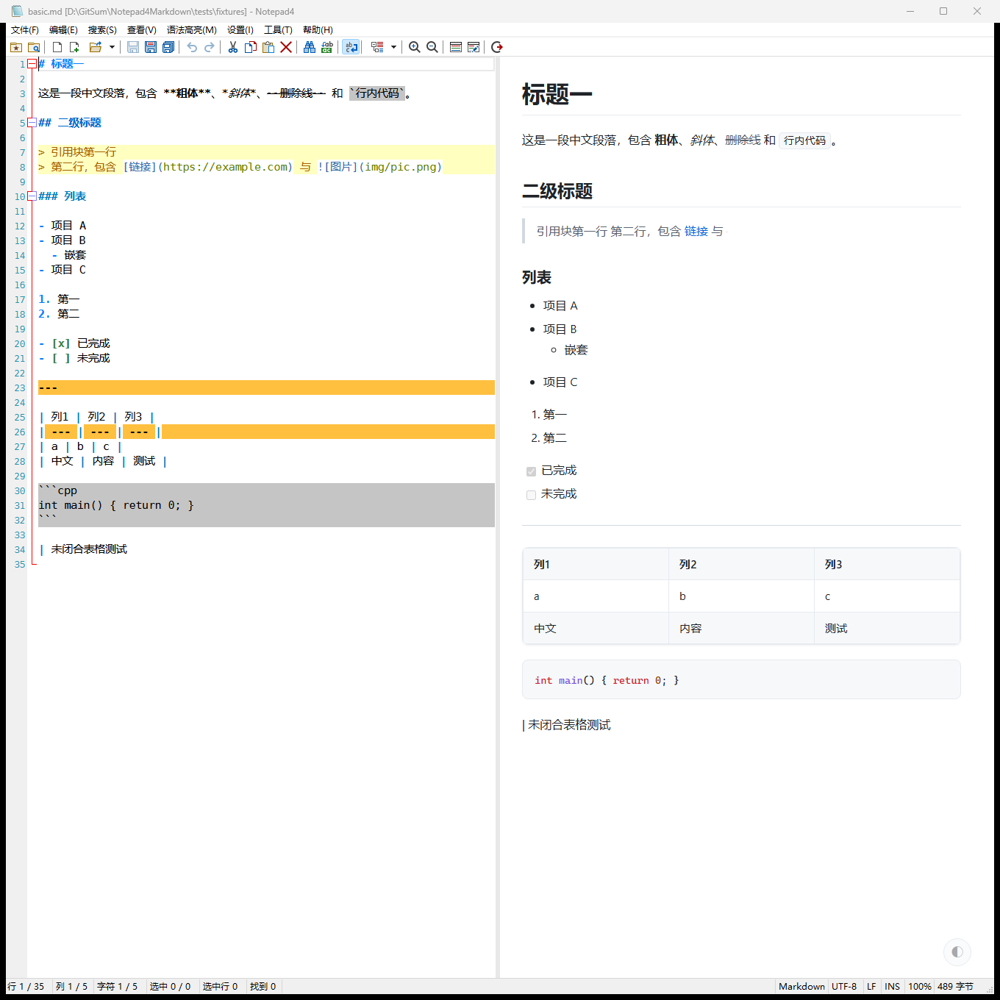

# Notepad4 Markdown 实时预览

[](https://github.com/2kil/Notepad4Markdown/actions/workflows/build.yml)
[](https://github.com/2kil/Notepad4Markdown/releases)

给 [Notepad4](https://github.com/zufuliu/notepad4) 加一个**同窗口内的 Markdown 实时预览**：
编辑 `.md` 时按 `Ctrl+Alt+M` 分栏，左边改字、右边 250 ms 后跟上；也可以直接进入整窗阅读视图。
预览用的是编辑器内存里的文本，**不需要先保存**。



> 基线源码：`zufuliu/notepad4` 提交 `bc6c799`（2026-10-18，BSD 3-Clause），见 `upstream.lock`。
> 交付形态：**主程序补丁 + 独立模块**，预览编译进 `Notepad4.exe`，不引入独立进程、不开本地端口。

文档结构：项目目的 → 架构说明 → 源代码结构 → 编译说明 → 使用说明 → 场景对照 → 已知限制。

---

## 1. 项目目的

### 1.1 解决的问题

Notepad4 内置 Markdown **语法高亮**，但没有渲染能力：写 README、写笔记时看不到最终排版，
只能另开浏览器或别的编辑器。本项目补上这一段——不改变 Notepad4 的编辑体验，只增加一个可开关的预览面板。

### 1.2 功能清单

| 能力 | 说明 |
| --- | --- |
| 边改边看 | 读 Scintilla 内存缓冲区，未保存内容也能预览；防抖 250 ms，可关自动刷新 |
| 两种形态 | **阅读视图**（编辑器收起、整窗阅读，打开 `.md` 默认进入）与**分栏预览**（左编辑右预览） |
| 双主题 | 跟随编辑器明暗配色，也可用页面右下角 ◐ 按钮手动切换 |
| GFM 渲染 | 标题、段落、引用、分隔线、有序/无序/任务列表、粗斜体、删除线、行内代码、代码块（本地 highlight.js 高亮）、表格、链接、图片、HTML 实体、自动链接 |
| GitHub 风格 README | 保留原始 HTML 并按白名单重建，`<div align>`、徽章、`<details>`、emoji 正常显示 |
| 目录跳转 | 标题自动生成 GitHub 同规则 `id`，`[文字](#锚点)` 点击即跳到对应章节，重复标题自动加 `-1`/`-2` |
| 图片 | 本地相对路径（同目录 / 子目录 / `./`）、`http(s)` 远程图、`data:image/*` |
| 中文友好 | 默认简体中文界面；UTF-8 / 系统代码页都能正确解码；中文字体回退 |
| 一键带走 | 单个 `Notepad4.exe`，预览资源与中文界面全部内嵌，无 `res\`、无 `locale\`、无 CDN |
| 随时关闭 | 面板/视图可关闭，关闭后无后台渲染；不影响原有编辑、保存、查找、快捷键 |

### 1.3 关键结论

| 问题 | 结论 |
| --- | --- |
| 是 DLL 插件吗？ | **不是**。Notepad4 没有插件 API（无 `NPPM_*`、无 `LoadLibrary` 扩展点），因此采用**最小主程序补丁**：11 个文件、`+4490 / −7` 行，其中 4 个是新增模块、1 个是生成的中文资源块 |
| 能预览未保存内容吗？ | **能**。内容来自 `SCI_GETTEXT`，不读磁盘 |
| 有自动刷新吗？ | **有**，默认开启，250 ms 防抖，可菜单关闭 |
| 图片支持到什么程度？ | 本地相对路径 + 网络 + `data:`；仅允许读取**当前文档目录及子目录**内的图片 |
| 界面语言？ | **默认简体中文**（`UILanguage` 缺省 `2052`），可在「设置 → 语言」切换 |
| 打开 `.md` 默认看到什么？ | 默认进入**阅读视图**（编辑器收起）；菜单「打开 Markdown 文件时显示预览」可关闭该行为 |
| 怎么安装？ | 用构建产物替换 `Notepad4.exe` 即可，单文件 |
| 验证到什么程度？ | 自动化 124 项（100 单测 + 24 真实编辑器集成）全部通过；未验证项见第 7 节 |

### 1.4 与上游的关系

* **只做加法**：新增模块 + 12 个挂钩点（17 处一行调用），不改写原有函数逻辑。
* **可回移**：全部改动收敛在 `patch/0001-notepad4-markdown-preview.patch`，`git apply --check` 通过。
* **许可证**：上游 BSD 3-Clause 原样保留；本项目新增代码为 MIT；第三方许可见 `LICENSE-THIRD-PARTY.md`。

---

## 2. 架构说明

### 2.1 进程与窗口结构

```
Notepad4.exe（单进程）
├─ hwndReBar                 工具栏
├─ hwndEdit                  Scintilla 编辑器（左侧）
├─ hwndSplitter              6 px 分隔条（可拖动 / 双击复位）
├─ hwndPane                  预览面板（右侧）
│    └─ WebView2 子窗口      https://notepad4.mdpreview/ 虚拟域
└─ hwndStatus                状态栏
```

* 分栏布局在 `MsgSize()` 里接管：编辑器让出右侧空间，三部分（编辑器 + 分隔条 + 面板）宽度之和等于客户区。
* **阅读视图**下编辑器与分隔条隐藏，面板 `0, top, cx, cy` 占满客户区——只改显示，不碰文档。
* 面板宽度以 DIP 记录（默认客户区一半），拖动后写入 `Notepad4.ini`，跨 DPI 切换按比例换算。

### 2.2 渲染与同步链路

```
SCN_MODIFIED ──▶ SetTimer(debounce) ──▶ 到期
                                          │
                       主线程：抓取缓冲区文本（SCI_GETTEXT）+ 元信息
                                          │ 投递任务（新任务覆盖旧任务）
                                          ▼
                       工作线程：md4c 渲染 → 写入 LocalContent（加锁）
                                          │ PostMessage(WM_MDPREVIEW_RENDERED, version)
                                          ▼
                       主线程：version 比较（丢弃过期）→ 通知页面
                                          │
                       页面：fetch /__doc → 替换 DOM → postMessage 回报
```

1. **未保存内容**：读内存缓冲区，不碰磁盘。
2. **防抖**：复用同一 `SetTimer` ID，等价于「最后一次输入后 250 ms 触发」。
3. **不阻塞 UI**：md4c 在工作线程渲染；主线程只做取文本（Scintilla 仅主线程可访问）与页面通知。
4. **任务合并**：工作线程只保留最新任务，连续输入不排队。
5. **防竞态**：每次请求带单调递增 `version`，主线程与页面都丢弃旧版本，切换文档不会旧内容覆盖新内容。
6. **文档身份变化**：`FileLoad` / `FileSave` 成功后立即全量刷新；打开非 Markdown 文件退出阅读视图。
7. **自动刷新关闭**：`SCN_MODIFIED` 直接返回，不设置任何定时器。
8. **错误可见**：渲染失败、体积超限、WebView2 异常都会给出中文提示（面板内或对话框）。

### 2.3 模块分层

| 层 | 文件 | 职责 | 依赖方向 |
| --- | --- | --- | --- |
| 集成层 | `notepad4/src/MarkdownPreview.h/.cpp` | 挂钩点、分栏布局、分隔条、防抖、后台渲染线程、菜单状态、ini | → 视图层 |
| 视图层 | `notepad4/src/MarkdownPreviewView.h/.cpp` | 容器窗口、WebView2 生命周期、虚拟域资源路由、导航白名单、兼容模式 | → WebView2 SDK |
| 内容层 | `preview/src/LocalContent.h/.cpp` | 渲染结果缓存、`/__doc` `/__meta` 与图片路由、快照导出、内嵌资源读取 | → 渲染层、编码层 |
| 渲染层 | `preview/src/MarkdownRenderer.h/.cpp` | md4c 封装、HTML 白名单重建、URL 白名单、快照 URL 改写（不依赖 Win32，便于单测） | → md4c |
| 编码层 | `shared/text_encoding.h/.cpp` | UTF-8 / 系统代码页互转 | → Win32 |
| 前端 | `preview/res/shell.html`、`app.css`、`app.js`、`highlight.min.js` | 页面骨架、排版与主题、正文拉取、语法高亮 | — |
| 第三方 | `third_party/md4c`、`third_party/webview2` | Markdown 解析、内嵌浏览器 SDK | — |

### 2.4 为什么是"编入主程序"而不是插件或独立进程

| 方案 | 结论 |
| --- | --- |
| A. 纯 DLL 插件（零改主程序） | **不可行**：Notepad4 无插件 API。`src/` 内所有 `LoadLibrary` 只加载系统 DLL；无 `NPPM_*`；`matepath` 只是 `ShellExecuteEx` 启动外部 exe |
| B. 独立预览进程 + 跨进程 `SetParent` | 可行但脆弱：WebView2 的输入、焦点、DPI、合成链路都假设宿主窗口属于本进程，跨进程嵌入会出现焦点丢失、输入法异常、缩放错乱 |
| **C. 预览模块编入主程序 + 同窗口分栏** | **采用**：真正的同窗分栏，拖动、焦点、高 DPI 由同一 UI 线程管理 |
| D. 独立进程 + 独立窗口 | 早期实现，已移除（不满足"原窗口内显示"的要求） |

代价与缓解：

* exe 从约 3.0 MB 增至约 3.5 MB（md4c + 预览模块；WebView2 走系统运行时，不打包）。
* WebView2 的 COM 生命周期在编辑器进程内——用 `ComPtr` 严格管理，`WM_DESTROY` 统一释放。
* Chromium 渲染进程仍是独立进程（`msedgewebview2.exe`），页面崩溃不会带走编辑器。

### 2.5 资源与本地化内嵌

* **页面资源**：`shell.html` / `app.css` / `app.js` / `highlight.min.js` 以 `RCDATA`（ID 210–213）编入 exe。
  读取顺序是「exe 旁的 `res\` 目录优先，其次内嵌副本」——开发时改 CSS 刷新即可，不必重编译。
* **中文界面**：`scripts/gen_locale_rc.py` 从上游 `locale/zh-Hans/Notepad4.rc` 抽取 `LANG_CHINESE` 资源块，
  去掉与主资源冲突的图标/位图/清单，生成 `build/generated/Notepad4.zh-Hans.rc` 由主 rc 包含；
  启动时按 `UILanguage` 调 `SetThreadUILanguage()`，让 `LoadString` / `LoadMenu` / `DialogBox` 命中中文块。
* 结果：分发只有一个 `Notepad4.exe`；只有想用简体中文以外的界面时，才需要外置语言包 DLL。

### 2.6 安全设计

预览页运行在虚拟域 `https://notepad4.mdpreview/`，**不存在本地 HTTP 服务、不开放端口**，
所有请求都在进程内由 `LocalContent::Serve()` 回答。

**页面侧**

* 原始 HTML **白名单重建**（不是简单放行）：标签白名单约 70 个；`script/style/iframe/object/embed/svg/math/form` 等
  连同内容整段丢弃；属性按标签白名单放行，`on*`、`srcdoc`、`formaction` 一律不保留；
  `style` 含 `expression`、`javascript:`、`behavior`、`@import` 时丢弃；`<input>` 只允许 `type="checkbox"`。
* CSP：`default-src 'none'` 起步，只放行同源样式/脚本与 `img-src https: http: data:`；
  导出的离线快照额外放行 `file:`（用于重写后的本地图片路径）。
* 页面无 `eval`、无内联事件处理器；外部链接由宿主 `NavigationStarting` 拦截后交给系统浏览器。

**URL 白名单**（`IsUrlAllowed()`）

* 允许：`http:`、`https:`、`mailto:`、相对路径；图片额外允许 `data:image/*`（单张 ≤ 2 MB）。
* 拒绝：`javascript:`、`vbscript:`、`file:`、非图片 `data:`、含控制字符的伪协议（如 `java\tscript:`）、协议相对 `//host`。
* 被拒绝的 URL 替换为占位符，不进入 DOM。

**本地资源读取范围**

| 路径 | 内容 |
| --- | --- |
| `/__doc` | 当前渲染结果 |
| `/__meta` | 标题、编码、修改状态、错误文本、版本号 |
| `/__app/*` | 内嵌的 CSS / JS / highlight.js |
| `/<相对路径>` | 文档目录及子目录内的**图片**（png/jpg/gif/webp/svg/bmp/ico/avif） |

规范化后必须仍在文档目录内；`..`、`%2e%2e`、绝对路径、盘符一律 404；非图片扩展名一律 404；
未保存文档没有目录，所有相对资源 404。

越界校验是两层的：字符串层面拒绝 `..` 及其变体（含 Win32 会吞掉的尾随空格 / 点，如 `.. `），
打开文件后再用 `GetFinalPathNameByHandleW` 取真实路径复核一次——这样 junction、符号链接也无法把
读取带出文档目录。

**HTML 清洗的边界处理**

* `<script>` / `<style>` 等内容整段丢弃；**结束标签缺失时只丢弃该标签本身**，不会吞掉后面的正文。
* `srcset` 按逗号拆分，逐个候选校验 URL（整串只看开头会被后续候选绕过）。
* `loading="lazy"` 一律丢弃：面板被遮挡时 Chromium 会无限期推迟懒加载。
* 标签边界扫描会跳过引号内的 `>`，`<div title="a>b">` 不会被截断。

**导航与日志**

* `AreDefaultContextMenusEnabled` / `AreDevToolsEnabled` / `AreBrowserAcceleratorKeysEnabled` 全部 `FALSE`。
* `NewWindowRequested` 一律拦截，仅 `http/https` 交给系统浏览器。
* 宿主只接收页面上报的 `{type, version, chars, images}`，**从不**把页面消息当命令执行。
* 诊断日志（`NOTEPAD4_MDPREVIEW_LOG=1`）只记环境初始化、导航结果、进程失败类型、版本号与字符数，
  **不记录文档内容与文件路径**。

### 2.7 受限环境下的兼容模式

部分机器（组策略、EDR、受限沙箱）会反复终止 Chromium 的 GPU / utility 子进程。此时：

* 默认浏览器参数为 `--disable-gpu --disable-gpu-compositing`（Markdown 是静态文本，软件合成无感知差异）；
* 连续 3 次 `ProcessFailed`（GPU / utility / sandbox-helper）自动切到 `--no-sandbox` 并重建一次；
* 环境或控制器创建失败（如 `0x8007139F`）按 600 ms 起、每次 +450 ms 退避重试，最多 4 次；
* 想恢复 GPU 加速：ini 里设 `browserargs=gpu`。

### 2.8 第三方依赖

| 依赖 | 版本 | 许可证 | 用途 |
| --- | --- | --- | --- |
| md4c | 0.5.2 | MIT | Markdown → HTML（GFM 扩展） |
| WebView2 SDK | 1.0.3351.48 | Microsoft（可再分发） | 内嵌浏览器控件 + 静态导入库 |
| highlight.js | 11.11.1 | BSD-3-Clause | 代码块高亮（本地文件，无 CDN） |
| WebView2 Runtime | 系统已安装 | Microsoft | 运行时（Win11 自带） |

`md4c.c` / `entity.c` 有两个 `qsort` 比较函数加了 `__cdecl`——Notepad4 全局 `/Gv`（`__vectorcall` 缺省），
不改会 `C2440`；改动已注释，其余与上游一致。

---

## 3. 源代码结构

### 3.1 仓库目录

```
Notepad4Markdown/
├── .github/workflows/build.yml    CI：构建 → 单测 → 打包 → 发 Release
├── upstream.lock                  上游仓库与锁定提交（补丁基线）
├── patch/0001-…patch              全部上游改动（唯一载体）
├── notepad4/                      ← 生成目录，不入库：fetch_upstream.py 拉取并打补丁
│   ├── src/MarkdownPreview.*          集成层（新增）
│   ├── src/MarkdownPreviewView.*      视图层（新增）
│   └── build/generated/Notepad4.zh-Hans.rc   生成的中文资源块
├── preview/
│   ├── src/MarkdownRenderer.*     md4c 封装 + HTML 清洗 + URL 白名单 + 快照改写
│   ├── src/LocalContent.*         渲染缓存 + 虚拟域资源路由 + 内嵌资源
│   └── res/                       shell.html / app.css / app.js / highlight.min.js
├── shared/text_encoding.*         UTF-8 与代码页互转
├── third_party/
│   ├── md4c/                      MIT，Markdown 解析（含 2 处 __cdecl 本地修改）
│   └── webview2/                  SDK 头文件 + x64 静态导入库
├── tests/
│   ├── mdtest.cpp                 100 项单元测试（渲染 / 安全 / 路由 / 快照）
│   ├── mdtest.vcxproj             单测工程（CI 用 msbuild 编译）
│   ├── integration_test.cpp       24 项真实编辑器集成测试
│   └── fixtures/                  basic.md / images.md / unsafe.md / img/*.png
├── scripts/
│   ├── fetch_upstream.py          按 upstream.lock 浅克隆上游 + git apply
│   ├── build.cmd / build_notepad4.cmd / build_locale.cmd
│   ├── package.ps1                打发布包（zip + sha256）
│   ├── gen_locale_rc.py           生成可内嵌的中文资源块
│   ├── run_tests.cmd              编译并运行全部测试
│   └── dev/                       调试小工具（截图、窗口枚举）
├── docs/                          README 截图
├── LICENSE / LICENSE-THIRD-PARTY.md
├── build/                         构建产物（不入库）
└── dist/                          发布包（不入库）
```

### 3.2 模块职责与阅读顺序

| 文件 | 行数 | 职责 |
| --- | --- | --- |
| `notepad4/src/MarkdownPreview.cpp` | 982 | 挂钩入口、分栏布局、分隔条、阅读视图、防抖定时器、渲染线程、菜单勾选、ini 读写 |
| `notepad4/src/MarkdownPreviewView.cpp` | 1071 | 容器窗口、WebView2 初始化与重建、`WebResourceRequested` 路由、导航拦截、诊断日志 |
| `preview/src/MarkdownRenderer.cpp` | 977 | md4c 回调、GFM 标志、HTML 白名单重建、URL 白名单、快照 `file:///` 改写 |
| `preview/src/LocalContent.cpp` | 579 | `/__doc` `/__meta` 路由、图片读取与越界校验、内嵌资源（`FindResourceW`）、HTML 快照导出 |
| `shared/text_encoding.cpp` | 56 | `WideToUtf8` / `Utf8ToWide` / `ToUtf8` |

建议阅读顺序：`MarkdownPreview.cpp`（整体流程）→ `LocalContent.cpp`（页面拿什么）→ `MarkdownRenderer.cpp`（内容怎么来）→ `MarkdownPreviewView.cpp`（怎么显示）。

### 3.3 对上游的改动

`patch/0001-notepad4-markdown-preview.patch`（11 个文件，`+4490 / −7`）：

| 文件 | 改动 |
| --- | --- |
| `src/MarkdownPreview.h/.cpp` | **新增**：集成层（见 3.2） |
| `src/MarkdownPreviewView.h/.cpp` | **新增**：视图层（见 3.2） |
| `src/Notepad4.cpp` | 12 处挂钩 + 默认界面语言改为简体中文 + `SetThreadUILanguage` |
| `src/Notepad4.rc` | 英文菜单、加速键、3 条字符串；4 个 RCDATA 资源；末尾 include 中文资源块 |
| `src/resource.h` | 6 个命令 ID（40960–40965）、4 个字符串 ID（61218–61221）、4 个资源 ID（210–213） |
| `locale/zh-Hans/Notepad4.rc` | 中文菜单项、加速键、字符串 |
| `build/VisualStudio/Notepad4.vcxproj` | 源文件、头文件路径、WebView2 静态库、`AdditionalInputs`、`/execution-charset:utf-8` |
| `build/mingw/notepad4.mk` | `NP2_DISABLE_MD_PREVIEW` + 排除预览源文件 |
| `build/generated/Notepad4.zh-Hans.rc` | **新增**：生成的中文资源块（勿手改） |

`Notepad4.cpp` 的挂钩点（全部是"一行调用"，不重构原函数）：

```
MsgSize()      → MarkdownPreview_Layout()          分栏 / 阅读视图布局
MainWndProc    → Shutdown / OnTimer / OnRenderComplete / FocusPreviewPane / OnDpiChanged
MsgInitMenu()  → MarkdownPreview_OnMenuInit()      勾选状态
MsgCommand()   → Toggle / RefreshNow / ToggleAutoRefresh / OpenInBrowser / Close / ToggleAutoOpen
MsgNotify()    → MarkdownPreview_OnEditorModified() SCN_MODIFIED
FileLoad()     → MarkdownPreview_OnDocumentLoaded()
FileSave()     → MarkdownPreview_OnDocumentChanged()
```

未改动：`scintilla/`、`src/Edit.cpp`、`src/EditLexers/`、`src/Helpers.cpp`、`src/Dialogs.cpp` 与其余语言目录。

---

## 4. 编译说明

### 4.1 环境要求

* Windows 10/11 x64
* Visual Studio 2019/2022/2026，含「使用 C++ 的桌面开发」（MSVC v142+）
* Windows SDK 10
* Python 3（仅用于拉取上游与生成中文资源块）
* WebView2 Runtime（Win11 自带；Win10 可能需要安装）

### 4.2 本地一键构建

```bat
scripts\build.cmd
```

依次完成：

0. 若 `notepad4\` 不存在：`fetch_upstream.py` 按 `upstream.lock` 浅克隆上游提交并 `git apply` 补丁；
1. `build_notepad4.cmd` 编译编辑器（预览模块与 CSS/JS 一并编入）；
2. 组装 `build\out\x64\`。

产物只有一个文件：

```
build\out\x64\Notepad4.exe    编辑器 + 预览 + CSS/JS + 简体中文界面（约 3.5 MB）
```

只想拉取/刷新源码树：

```bat
python scripts\fetch_upstream.py
python scripts\fetch_upstream.py --force     :: 删掉 notepad4\ 后重新拉取
```

### 4.3 分步构建

```bat
scripts\build_notepad4.cmd     :: 只编译编辑器（需先 fetch_upstream）
scripts\build_locale.cmd       :: （可选）单独生成 zh-Hans 语言包 DLL
msbuild tests\mdtest.vcxproj /p:Configuration=Release /p:Platform=x64   :: 只编译单测
```

### 4.4 测试

```bat
scripts\run_tests.cmd
```

* **阶段 1（`mdtest.exe`，100 项）**：Markdown 渲染、GFM、HTML 白名单、URL 协议、标题锚点、资源路由（越界 / 编码绕过 / 非图片）、版本号单调性、快照导出、图片加载统计。
* **阶段 2（`integration_test.exe`，24 项）**：真实启动 `Notepad4.exe`，用 `WM_COMMAND` / `WM_CHAR` 操作，断言布局、阅读视图、分隔条拖动、图片真的加载、进程存活，并输出截图到 `build\logs\`。

本机实测：

```
Stage 1  unit tests            100 项，失败 0 项       exit 0
Stage 2  editor integration    24 项，失败 0 项        exit 0
合计                            124 项，失败 0 项
```

排查单个文档：

```bat
mdtest.exe --render in.md out.html      :: 生成可独立打开的 HTML
integration_test.exe <某个.md>           :: 用真实编辑器打开并截图
set NOTEPAD4_MDPREVIEW_SHOT_DELAY=7000   :: 截图前多等，便于核对远程图片
```

### 4.5 打包

```powershell
powershell -ExecutionPolicy Bypass -File scripts\package.ps1 -Version v1.0.0
```

输出 `dist\Notepad4Markdown-v1.0.0-x64.zip` 与 `.sha256`，内含
`Notepad4.exe`、`README.md`、`LICENSE`、`LICENSE-THIRD-PARTY.md`、上游与 Scintilla 许可证。

### 4.6 GitHub Actions

`.github/workflows/build.yml`（`windows-latest`）在 push / PR / 手动触发时执行：

| 步骤 | 说明 |
| --- | --- |
| `python scripts/fetch_upstream.py` | 按 `upstream.lock` 复现补丁树 |
| `msbuild notepad4\build\VisualStudio\Notepad4.sln /t:Notepad4` | `Release` / `x64`，与本地同一工程 |
| `msbuild tests\mdtest.vcxproj` → 运行 | 100 项单测（无 GUI，可在无头 runner 跑） |
| `scripts/package.ps1` | 打出 zip + sha256 |
| `actions/upload-artifact` | 每次构建都可在 Actions 页面下载 |
| `gh release create/upload` | 仅 `v*` 标签触发，重复推送相同标签则覆盖附件 |

发布：

```bat
git tag v1.0.0
git push origin v1.0.0
```

注意：

* **CI 只跑单测**：集成测试需要真实桌面会话与 WebView2 窗口，无头 runner 上不可靠；全量 124 项请本地跑。
* **升级上游**：改 `upstream.lock` 的 `commit`，重新生成补丁并本地跑通后再提交——两者必须同步，否则 CI 的 `git apply` 会失败。
* 工作流监听 `main` / `master`，默认分支不同则改 `build.yml` 的 `branches`。

### 4.7 把补丁应用到自己的 Notepad4 检出

```bat
git clone https://github.com/zufuliu/notepad4.git
cd notepad4
git checkout bc6c799
git apply --check ..\patch\0001-notepad4-markdown-preview.patch
git apply ..\patch\0001-notepad4-markdown-preview.patch
```

目录必须与仓库同构：`preview/`、`shared/`、`third_party/` 放在 `notepad4/` 的**父目录**（工程用相对路径引用），
否则需要同步修改 `Notepad4.vcxproj` 里的 `AdditionalIncludeDirectories` 与源文件路径。

### 4.8 工程改动要点

* 源文件与头文件路径：`preview/src`、`shared`、`third_party/md4c`、`third_party/webview2/include`；
  链接 `WebView2LoaderStatic.lib`。
* `ResourceCompile` 的 `AdditionalInputs` 列出 4 个 `preview/res/*` 与生成的中文 rc——
  否则只改 CSS/JS 时 `rc.exe` 不重跑，exe 里仍是旧资源。
* 自有 5 个源文件加 `/execution-charset:utf-8`：上游只设了 `/source-charset:utf-8`，
  执行字符集默认取系统 ACP，英文系统上窄字符串中文会变 `?`。
* **MinGW 构建不含预览**：没有 WebView2 的 MSVC 静态库，`NP2_DISABLE_MD_PREVIEW` 下功能为空实现，
  编辑器行为与原生一致。

### 4.9 本机遇到的两个环境坑（脚本已内置规避）

1. `vcvars64.bat` 通过 `reg.exe` 查 Windows SDK，若被安全策略拦截会报 `MSB8036`；
   脚本显式传入 `IncludePath` / `LibraryPath` / `ResourceIncludePath` 并加 `WindowsSDKInstalled=true`。
2. 环境同时存在 `HTTPS_PROXY` 与 `https_proxy` 会让 MSBuild 的 CL 任务抛 `MSB6001`；
   脚本调用前清空这两个变量。

---

## 5. 使用说明

### 5.1 安装与卸载

**安装**：把 `Notepad4.exe` 覆盖到 Notepad4 安装目录（便携版直接替换）即可，无需其它文件。

**卸载**：用原始 `Notepad4.exe` 覆盖回去，再删除 `Notepad4.ini` 的 `[Markdown Preview]` 段与
`%LOCALAPPDATA%\Notepad4MarkdownPreview\`。

### 5.2 菜单与快捷键

| 操作 | 快捷键 / 位置 |
| --- | --- |
| 打开 `.md` 时显示预览 | 「查看 → Markdown 预览 → 打开 Markdown 文件时显示预览」（默认勾选） |
| 打开 / 关闭预览面板 | `Ctrl+Alt+M`，或「显示预览面板」 |
| 立即刷新 | `Ctrl+Alt+V`，或「刷新预览」 |
| 自动刷新开关 | 菜单「自动刷新」（勾选状态即当前状态） |
| 在浏览器中打开 | 菜单「在浏览器中打开」——导出独立 HTML 后用默认浏览器打开 |
| 关闭面板 | 菜单「关闭预览面板」 |
| 调整宽度 | 拖动中间分隔条；双击分隔条恢复「客户区一半」 |
| 切换主题 | 预览页右下角 ◐（跟随系统 / 浅色 / 深色） |

### 5.3 两种形态

* **阅读视图**（打开 `.md` 默认进入）：编辑器隐藏，渲染结果占满窗口，适合阅读与核对排版。
  按 `Ctrl+Alt+M`、菜单「显示预览面板」或「关闭预览面板」回到编辑。
* **分栏预览**（手动 `Ctrl+Alt+M` 打开）：编辑器在左、预览在右，边改边看。


行为说明：

* 预览只影响显示，**不会修改文档**；切回编辑后未保存的修改、光标位置、滚动位置都在。
* 打开非 Markdown 文件（`.txt`、`.cpp` 等）自动退出阅读视图。
* 正文铺满面板，左右各留固定 **30 px**；表格、代码块超宽时内部横向滚动。
* 预览跟随编辑器的明暗配色（读取 Scintilla 默认样式背景亮度）。

### 5.4 支持的 Markdown

ATX 标题、段落、引用、分隔线、有序/无序/任务列表、粗体/斜体/删除线/行内代码、围栏代码块（语言高亮）、
表格、链接、图片、HTML 实体、自动链接、`<details>` 等 GitHub 风格扩展；
中文、Unicode、emoji 正常；相对路径图片、网络图片、`data:` 图片都能显示。

不支持：数学公式、图表（Mermaid）、嵌入视频。

### 5.5 配置

`Notepad4.ini` 的 `[Markdown Preview]` 段，全部可选：

| 键 | 默认值 | 说明 |
| --- | --- | --- |
| `openmdpreview` | `1` | 打开 `.md` 时是否进入阅读视图；`0` 保持编辑视图 |
| `autorefresh` | `1` | 是否自动刷新；`0` 时只有手动刷新会渲染 |
| `debounce` | `250` | 防抖毫秒数（30–5000） |
| `maxsizemb` | `32` | 单次渲染体积上限（MB），超出提示并跳过 |
| `panelwidth` | `0` | 面板宽度（DIP）；`0` = 客户区一半；拖动后自动写入 |
| `browserargs` | 空 | WebView2 附加参数；`gpu` 恢复 GPU 加速，也可填任意 Chromium 参数 |

```ini
[Markdown Preview]
openmdpreview=1
autorefresh=1
debounce=200
panelwidth=560
```

### 5.6 排查

| 现象 | 处理 |
| --- | --- |
| 面板空白 / 一直显示"正在启动预览引擎" | 确认已安装 WebView2 Runtime；设 `NOTEPAD4_MDPREVIEW_LOG=1` 后查看 `%LOCALAPPDATA%\Notepad4MarkdownPreview\webview2.log` |
| 提示"预览渲染进程已退出" | 点「刷新预览」重试；受限环境会自动进入兼容模式 |
| 图片显示不出来 | 本地图片必须在文档目录或其子目录内；网络图片需要联网，离线时显示 alt 文本 |
| 界面是英文 | ini 里 `UILanguage` 被改成非中文（改回 `2052` 或删除该键后重启） |
| 文档太大不渲染 | 超过 `maxsizemb`（默认 32 MB），可在 ini 中调大 |

---

## 6. 场景对照

| 场景 | 状态 | 说明 |
| --- | --- | --- |
| 打开 `.md` 直接进入预览视图 | ✅ | 默认开启，集成测试覆盖 |
| 取消开关后打开 `.md` 为编辑视图 | ✅ | 集成测试（切换菜单 + 重新加载） |
| 普通 Markdown 文件 | ✅ | `tests/fixtures/basic.md` |
| GitHub 风格 README（HTML 排版） | ✅ | 用 `TikTokDownloader/README.md` 实测：居中容器、徽章、`<details>`、emoji 均正常 |
| HTML 中的本地图片 | ✅ | 页面从根路径加载，`./static/a.png` 正确解析到文档目录 |
| 中文 / Unicode / emoji | ✅ | 单元测试覆盖，截图可见中文排版 |
| 未保存内容实时预览 | ✅ | 集成测试键入后页面重新渲染 |
| 表格 / 任务列表 / 引用 / 代码块 | ✅ | 截图与单元测试 |
| 相对路径图片 | ✅ | 进程内白名单路由，越界 404 |
| 网络图片（`http(s)://`） | ✅ | 由 WebView2 直接下载；离线时显示 alt 文本与虚线框 |
| `data:image/*` 内嵌图片 | ✅ | 单张上限 2 MB |
| 图片实际加载成功 | ✅ | 页面把 `{total,loaded,failed}` 回报宿主，集成测试断言 `loaded ≥ 1` |
| 超长文档 | ⚠️ 代码就绪，未做 100 MB 压测 | 32 MB 上限可配置 |
| 连续快速输入 | ✅ | 防抖 + 任务合并 + 版本丢弃 |
| 多文档切换 | ⚠️ 代码路径已接（`FileLoad`/`FileSave`），未自动化 | 单文档模型下等价于重新加载 |
| 关闭后重新打开 | ✅ | 集成测试 |
| 原始 HTML / 恶意链接 | ✅ | 单元测试 |
| 预览渲染进程异常退出 | ✅ | `ProcessFailed` → 中文提示 / 兼容模式 |
| 原有编辑、保存、查找、快捷键 | ✅ | 集成测试确认进程存活、布局恢复 |

---

## 7. 已知限制与未验证项

1. **没有 DLL 插件形态**：预览编入 `Notepad4.exe`，升级上游时需要重新应用补丁。
2. **MinGW 构建不含预览**：没有 WebView2 的 MSVC 静态库；已用 `NP2_DISABLE_MD_PREVIEW` 让该构建保持可用。
3. **仅 x64 实机验证**：工程为 x64 配置；ARM64/Win32 未构建验证。
4. **多显示器 / 高 DPI**：代码在 `WM_DPICHANGED` 里重排并更新 `RasterizationScale`，但未在多屏混合缩放环境下实测观感。
5. **超大文档**：未做 100 MB 级压测；当前上限 32 MB（可配置），超过则提示并跳过。
6. **延迟渲染路径未压测**：工作线程渲染在 1 MB 级文档上约 10–20 ms，未做系统性基准。
7. **内嵌语言只有简体中文**：想用日/韩/繁体等界面，仍需把对应的 `locale\<lang>\Notepad4.dll` 放到 exe 旁（上游机制）。
8. **受限环境的兼容模式**：本机（安全策略禁用 `reg.exe`、拦截 Chromium 子进程）需要 `--no-sandbox` 才能出画面；
   在正常 Windows 上不会触发。触发时会自动降级并提示；初始化失败（如 `0x8007139F`）会自动退避重试 4 次。
9. **网络图片依赖外网**：远程图片由 WebView2 下载，首次显示有网络延迟（通常 0.2–2 s）；离线时保留 alt 文本。
   本地图片与 `data:` 图片不受影响。
